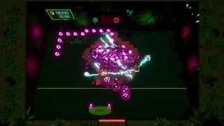
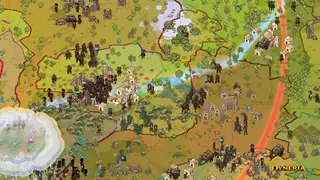
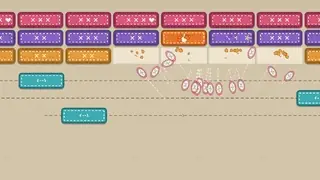
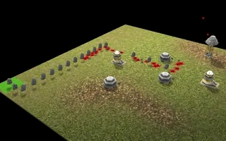
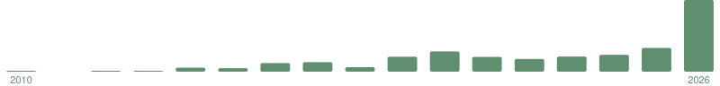
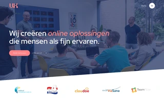
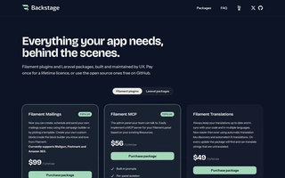
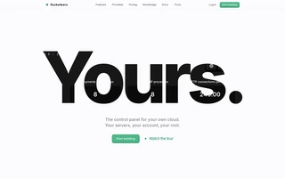

### Hi, I'm Mathieu, aka Casmo

I'm a developer at [UX](https://ux.nl), building large Laravel platforms and open source tools. I'm also the founder of [Couchfriends](https://couchfriends.com) and [Spark of Chaos](https://sparkofchaos.com), where I make games with Unreal Engine, Three.js and more.

## Games

<table>
  <tr>
    <td width="33%" valign="top">
       
      <a href="https://store.steampowered.com/app/3628790/Kabonk/"><strong>Kabonk!</strong></a> — Unreal Engine 5, on Steam
    </td>
    <td width="33%" valign="top">
      <!-- clip: fernweh.webp -->
      <a href="https://store.steampowered.com/app/5467940"><strong>Fernweh</strong></a> — Three.js, coming to Steam
    </td>
    <td width="33%" valign="top">
       
      <a href="https://store.steampowered.com/app/5096670"><strong>Dyneria</strong></a> — custom Rust/wgpu engine, coming to Steam
    </td>
  </tr>
  <tr>
    <td width="33%" valign="top">
       
      <strong>Bonk!</strong> — Godot, in development
    </td>
    <td width="33%" valign="top">
      <!-- clip: treejs.webp -->
      <a href="https://mathieuderuiter.nl/tree.js/"><strong>tree.js</strong></a> — procedural trees, Three.js / WebGPU
    </td>
    <td width="33%" valign="top">
      <!-- clip: spaceshooter.webp -->
      <a href="https://casmo.itch.io/spaceshooter-3"><strong>Spaceshooter</strong></a> — TypeScript, PixiJS
    </td>
  </tr>
  <tr>
    <td width="33%" valign="top">
      <!-- clip: couchfriends.webp -->
      <a href="https://couchfriends.com"><strong>Couchfriends</strong></a> — phone-as-controller party games, open source
    </td>
    <td width="33%" valign="top">
       
      <a href="https://casmo.itch.io/threejs-tower-defense"><strong>Tower Defense</strong></a> — Three.js
    </td>
  </tr>
</table>

## Web development

1. PHP and CakePHP: browser game engine, contributor to CakePHP and its docs.
2. HTML5 and Node.js: Three.js / PixiJS, WebSocket multiplayer, early TypeScript adopter; founded Couchfriends (open source).
3. Client platforms: CMS/CRM builds, Angular, tools for a tabletop RPG community (GoblinWorkshop).
4. Laravel at UX: large Laravel platforms (50M+ requests/month), Vue, React, Tailwind; SaaS products Rocketeers and Cloudoe.
5. Now: Filament and Backstage CMS (open source), plus AI agent tooling.

Open source contributions to: Laravel, CakePHP, Filament, Laravel Scout, Laravel Actions, PixiJS, Mailgun PHP

Organisations: UX, Couchfriends, Spark of Chaos, Backstage, Rocketeers, Cloudoe

<table>
  <tr>
    <td width="33%" valign="top">
       
      <a href="https://ux.nl">UX</a> — agency site, Laravel
    </td>
    <td width="33%" valign="top">
       
      <a href="https://backstagephp.com">Backstage</a> — Filament plugins and Laravel packages
    </td>
    <td width="33%" valign="top">
       
      <a href="https://rocketeersapp.com">Rocketeers</a> — control panel for your own cloud
    </td>
  </tr>
</table>

---

Blog: [mathieuderuiter.nl](https://mathieuderuiter.nl) · LinkedIn: [linkedin.com/in/mathieuderuiter](https://www.linkedin.com/in/mathieuderuiter/) · Spark of Chaos: [sparkofchaos.com](https://sparkofchaos.com)
